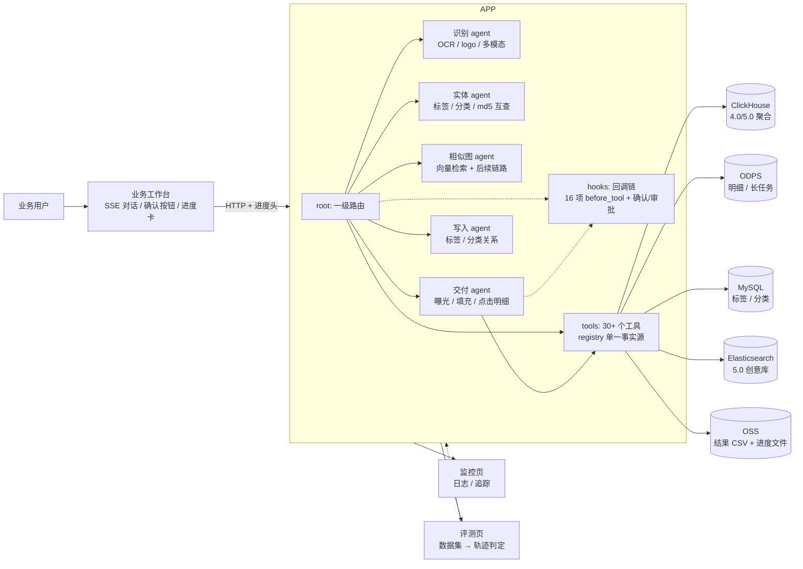

# 生产 Agent 系统：分层、决策与失败模式

> 本文描述一个广告素材分析 Agent 的生产形态。内部服务地址、模块名与业务数据已省略，
> 保留的是与工程判断相关的结构、取舍和踩过的坑。

## 1. 全景

系统把 30+ 个业务查询与写操作，组织成一个可审计、可恢复、可评测的多 Agent 应用，跑在托管运行时上，
前面挂三个入口：业务工作台（对话与确认）、监控页（日志与追踪）、评测页（数据集与轨迹判定）。

## 2. 关键设计决策

| 决策 | 为什么 | 代价 |
|---|---|---|
| root 只做一级路由，子 agent 禁止 transfer | 跨 agent 接力会让状态透传失控；每个子 agent 拥有完整工具集，链路在内部走完 | 子 agent 工具多，提示词更长 |
| registry 作为工具的唯一事实源 | 历史上存在三份手工名单（元数据、字段元数据、回显名单），各自漏项 | 新增工具要同时改注册表与提示词 |
| 结果分两个读者：模型看摘要，前端看表格 | 表格进上下文会撑爆 token，且模型会复述行数据 | 渲染层要维护两套视图 |
| 所有结果落对象存储，模型只拿「行数 + 列名 + 链接」 | 大结果不驻留内存，模型无法编造行内容 | 下游要支持链接作为输入 |
| 长查询用提交式（submit-only）+ 进度文件 | 托管运行时单请求 900 秒上限，ODPS 可能跑几十分钟 | 前端要轮询、要能恢复 |
| 写操作走原生 confirmation + 人工审批 | 不可逆动作必须人类确认；模型不能替用户点确认 | 确认态与重放要仔细处理 |
| 纯函数抽成独立模块 | 让参数语义可单测、可复用，不依赖 I/O | 多一层模块 |

## 3. 失败模式与防线

| 失败模式 | 症状 | 防线 |
|---|---|---|
| 参数静默失真 | 小时参数解析失败 → 不过滤小时 → 扫全天分区 | 契约层先拦，返回可自纠的 error |
| 查询范围被放大 | 媒体名未解析成 id，SQL 退化成全量 | 解析失败显式清空 + 后续工具缺 id 时拦截 |
| 模型跳步/乱序 | 素材 URL 直接当创意 md5 传 | 占位符还原 + 守卫 + 链路提示 |
| 重复调用 | 同一工具同参反复调 | 同参拦截、同工具最多 3 次、终态工具直出 |
| 长任务断流 | 页面刷新或服务重启后无结果 | 进度文件 + 实例 ID + 前端轮询恢复 |
| 结果过大 | 数十万行一次性读入导致 OOM | 逐行流式落盘 + 分片上传 |
| 提示词与工具职责漂移 | 路由表说 A，工具实际做 B | registry + 契约测试 + 评测集 |

## 4. 关键指标

- 工具：30+ 个只读/写入工具，6 个子 agent；
- 数据源：4 类（CK / ODPS / MySQL / ES），4.0/5.0 双版本口径；
- 长任务：单请求 900 秒上限 → 提交即返回，进度文件 8 秒节流，心跳 15 秒；
- 大结果：50 万行实测曾导致 OOM（峰值约 5.8GB），改造后内存只保留单行 + 分片缓冲；
- 评测：3 份数据集（创意口径 / 事件口径 / 冒烟），判定「工具轨迹 + 是否真有 functionResponse」。

## 5. 演进过程

1. 单 agent + 20 个工具 → 路由混乱、提示词膨胀；
2. 拆成 6 个子 agent + registry → 归属清晰，但状态透传依赖回调链；
3. 引入结果双读者、进度文件、确认审批 → 可用性与安全性；
4. 评测页 + 监控页 + 静态检查 → 从「能跑」到「可回归」；
5. 进行中：精简抽象、补单测与 CI、把确定性流程往图编排迁移。

第 5 步的产物就是本仓库：`toolcore/` 是这次抽象的内核，`adk/`、`langchain/`、`langgraph/` 是迁移过程中的
框架对照实验。
