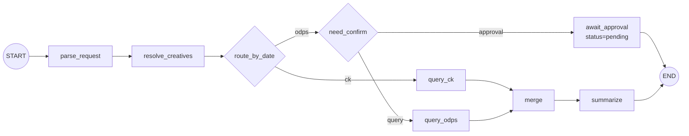

# LangGraph 复刻：素材 → 创意 → 落地页/深链 → 合并

不是重写生产系统，而是用另一套编排模型表达**同一条确定性链路**，用来回答面试问题：
「你为什么选 ADK？边界在哪？」

## 跑起来

```bash
pip install -r requirements.txt
python graph.py --demo
```

`--demo` 跑三个场景（固定日期，保证可复现）：

1. 素材 URL + 7 天内历史 → CK 快速路径，直接出结果；
2. 素材 URL + 今天 → ODPS，**先挂起等确认**；
3. 确认后重跑 → ODPS 完成，返回 dsp_id / ts。

## 图结构



## 与 ADK 版的对照

| 维度 | ADK（生产） | LangGraph（本目录） |
|---|---|---|
| 顺序由谁保证 | 提示词规则 + hook 守卫 | 图的边，代码写死 |
| 日期分流 | core 里的 if/else | `route_by_date` + 条件边 |
| 确认 | 原生 `request_confirmation` + 重放 | `need_confirm` 节点 + 状态标志 |
| 状态 | session state + 进度文件 | 图状态（可接 checkpointer） |
| 断点续跑 | 自建进度文件 + 前端轮询 | checkpointer / 状态重放 |
| 工具选择 | 模型自主选 | 不需要选，节点固定 |
| 适合 | 开放式问法、工具多 | 流程确定、要审计 |

## 三个观察（面试可以讲）

1. **控制流归属**：ADK 把「下一步走哪」交给模型，靠提示词和守卫兜；LangGraph 把它写进边。前者灵活、后者可预测，代价不同。
2. **确认语义**：ADK 的原生 confirmation 更贴「工具级审批」；LangGraph 的挂起/恢复更贴「流程级审批」。生产里两者都有（写操作 + 成本确认）。
3. **状态持久化**：生产用 OSS 进度文件解决「进程重启后恢复」，本质是在图外造了一个 checkpointer。如果一开始用图 + checkpointer，这部分代码会少很多。

## 边界结论

- 确定性收尾（素材链路、多日合并、字段收窄）→ 图；
- 开放式入口（理解用户问法、选工具）→ ADK 的 agent loop；
- 两者可以混：ADK agent 作为一个节点，或图节点里调 ADK runner。
