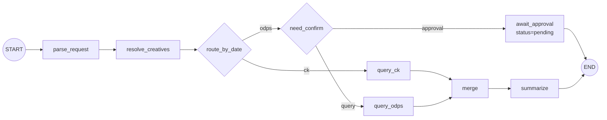

# LangGraph 实现：控制流写在图的边里

同一业务链路的三种编排实现之一。阶段语义来自 [`chaincore`](../chaincore/__init__.py)，这里只回答「下一步走哪」。

## 怎么表达控制流



- **两个分支都是条件边**：`route_by_date` 按日期决定 CK / ODPS；`need_confirm` 按是否已批准决定挂起还是查询。
- **挂起是一个终态**：`await_approval` 走到 `END`，`status=pending_approval`，由下一轮带着 `approved=True` 重新进入。

## 跑起来

```bash
pip install -r langgraph/requirements.txt
python langgraph/chain.py --demo
```

> 命名坑：安装的 `langgraph` 是**命名空间包**（没有 `__init__.py`），仓库里的 `langgraph/`
> 目录会被并进它的 `__path__`。所以必须用脚本方式运行（`python -m langgraph.chain` 会把本目录
> 当包导入），并且本目录里不能出现与库同名的子模块——`graph.py` 会撞上库的 `langgraph/graph/`，
> 这就是入口文件叫 `chain.py` 而不是 `graph.py` 的原因。

## 与其他两个实现的差异

| 维度 | 本实现 | LangChain | ADK |
|---|---|---|---|
| 控制流 | 图的边 | Runnable 组合 | Agent 顺序 + 节点守卫 |
| 分支 | 条件边，编译期定型 | `RunnableBranch` 运行时选 | 节点内部 if |
| 状态 | 图状态，逐节点合并 | 普通 dict 逐层传递 | Session state + `state_delta` |
| 可视化 | 图结构可直接画 | 无显式结构 | Agent 树 |

## 边界

- 这里没有用 checkpointer / `interrupt()`：挂起是用状态标志模拟的，**不是真正的持久化中断恢复**。要做真恢复，需要接 checkpointer 并把 `await_approval` 换成 `interrupt()`。
- 查询节点返回的是固定样本，不连真实数据源——这个仓库验证的是编排语义，不是查询性能。
